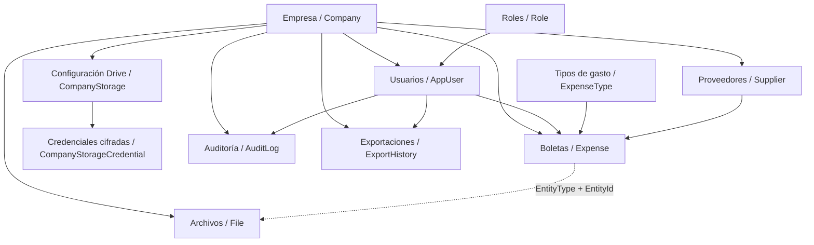

# Revisión del estado actual

Revisión del código local y consulta de metadatos de SQL Server. No se modificaron datos ni se probaron operaciones de escritura o llamadas a Drive. La revisión no equivale a una auditoría completa de seguridad ni a una prueba funcional de todas las pantallas.

## Modelo

SQL Server contiene 11 tablas de aplicación y `sysdiagrams`. Este esquema resume relaciones de negocio; File usa EntityType/EntityId como referencia lógica a la boleta.

Los archivos de imagen se gestionan en Drive; SQL conserva sus identificadores y metadatos. El backend accede a SQL Server mediante autenticación de Windows. No se extrajeron contraseñas, tokens ni registros personales.

## Avance encontrado

- Backend Express/TypeScript con login, bcrypt, JWT y middleware de roles.
- Consultas de lista y detalle de boletas filtradas por empresa y, para empleados, por usuario.
- Creación y edición de boletas, control previo de números duplicados y baja lógica.
- Integración OAuth con Drive, credenciales cifradas mediante AES-256-GCM y almacenamiento por empresa.
- Código para subir fotos por año/mes, reemplazarlas y moverlas al cambiar la fecha; compensaciones ante fallos parciales.
- Aplicación Expo/React Native con login, listado y formulario de boletas, cámara y galería.
- Componentes reutilizables y tema visual existentes.

## Diferencias entre SQL real y scripts

- Expense.Status tiene valor predeterminado PENDING en la base real; la migración 007 indica APPROVED.
- La base contiene CompanyStorageCredential, pero no se encontró su migración.
- File.UpdatedAt existe en SQL y es usado por el backend, pero falta en la migración 008.
- CompanyStorage.RootFolderId acepta NULL en SQL; la migración 009 lo declara obligatorio. El flujo OAuth crea primero la configuración sin carpeta.

Debe reconciliarse el historial de migraciones antes de desplegar una instalación nueva.

## Pendientes prioritarios

1. **Autorización de eliminación:** DELETE solo exige autenticación; el servicio filtra por empresa, sin propietario, rol ni estado. Un empleado podría dar de baja una boleta ajena dentro de su empresa o una aprobada si conoce el ID.
2. **Inmutabilidad:** el administrador puede editar boletas aprobadas. La protección debe aplicarse también en SQL al ejecutar el UPDATE.
3. **Imagen obligatoria:** tanto frontend como backend permiten crear una boleta sin imagen.
4. **Archivos temporales:** /uploads se sirve públicamente. La limpieza asigna la ruta después de validar campos; algunas respuestas tempranas pueden dejar archivos temporales. Revisar también el contenido real de las imágenes, además del MIME declarado.
5. **Aislamiento en relaciones:** validar que SupplierId pertenezca a la misma empresa; la referencia por ID no lo garantiza por sí sola.
6. **Autenticación:** OAuth state y tokens de sesión usan la misma clave; el middleware de sesión no comprueba propósito ni estructura del payload. Separar usos y validar claims. Revisar también desactivación de usuarios y roles durante sesiones vigentes.
7. **Login multiempresa:** el login busca por email y toma el primer resultado, mientras SQL permite el mismo email en empresas diferentes. Definir si el email será globalmente único o si el login seleccionará empresa.
8. **Aprobaciones:** no se encontraron endpoints de aprobación/rechazo individual o masivo, ni plazo de edición implementado.
9. **Auditoría:** existe AuditLog, pero no se encontraron escrituras desde los servicios revisados. Falta registrar actor, cambios y aprobaciones.
10. **Consistencia SQL/Drive:** probar fallos y operaciones simultáneas; las compensaciones manuales no equivalen a una transacción entre sistemas. Proteger duplicados y actualizaciones concurrentes.
11. **Impuestos:** el cálculo actual aplica 19% uniformemente. Falta definir y validar el tratamiento de combustible antes de implementarlo.
12. **Móvil:** tablero con espacio para estadísticas, servicio de dashboard con datos simulados, pantalla de reportes mínima; faltan detalle/edición, aprobación, filtros, gráficos y Excel conectados a datos reales.
13. **Entrega:** no se encontró configuración de CI ni una batería automatizada de pruebas. Definir desarrollo, pruebas y producción, ramas y promoción con revisión previa del usuario.

## Verificación realizada

- Consulta de sys.tables, sys.columns, sys.types y valores predeterminados: conexión exitosa; estructura actual leída.
- Backend: npm run typecheck pasó.
- Móvil: tsc --noEmit pasó.
- No se ejecutaron pruebas funcionales de creación, edición, borrado, aprobación o Drive.
- Había cambios locales previos en backend y archivos sin seguimiento. Se conservaron; no se hicieron commits, push ni despliegues.

## Secuencia propuesta

Primero corregir autorización e inmutabilidad y reconciliar migraciones; después completar aprobaciones y auditoría con pruebas entre empresas y usuarios. Luego conectar tablero, reportes y Excel y rediseñar las pantallas sobre esos flujos. Cada cambio debe quedar en una rama y ser revisable antes del commit, conforme a la indicación del usuario.
